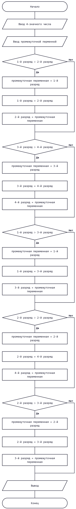

# Домашнее задание к работе 4
____

## Условие задачи
____

Дано четырехзначное число, запишите все его цифры в порядке
возрастания.

## 1. Блок-схема



## 2. Реализация программы

```c
#include <stdio.h>
#include <locale.h>

int task1();

int main() {

	// Кодировка
	setlocale(LC_ALL, ".UTF-8");

	task1();

	return 0;
}

int task1() {

	int number;

	puts("Введите четырехзначное число:");
	scanf("%d", &number);

	int first = number / 1000;
	int second = number % 1000 / 100;
	int third = number % 100 / 10;
	int fourth = number % 10;

    int temp;

    if (first > second) {
        temp = first;
        first = second;
        second = temp;
    }

    if (third > fourth) {
        temp = third;
        third = fourth;
        fourth = temp;
    }

    if (first > third) {
        temp = first;
        first = third;
        third = temp;
    }

    if (second > fourth) {
        temp = second;
        second = fourth;
        fourth = temp;
    }

    if (second > third) {
        temp = second;
        second = third;
        third = temp;
    }

    printf("Цифры в порядке возрастания: %d %d %d %d\n", first, second, third, fourth);

    return 0;
}

```

## 4. Информация о разработчике

**Терентьев Максим**
**бТИИ-262**
